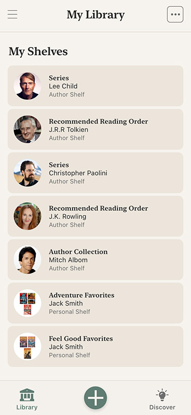
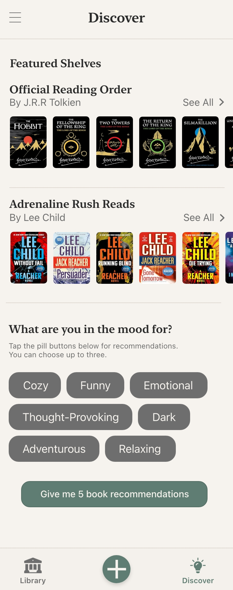
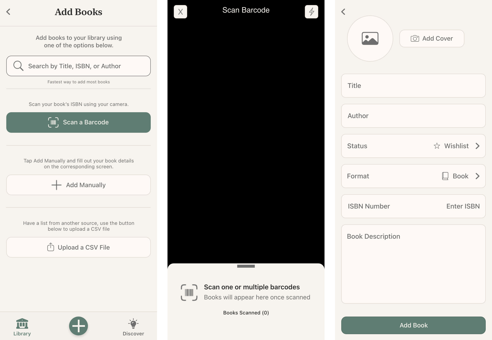
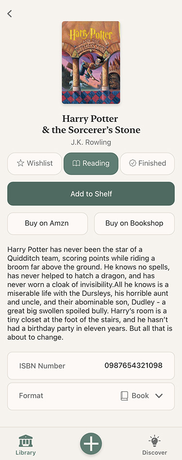

# 📚 Book Tracking App — UX/UI Case Study

A mobile-first UX/UI case study exploring the design of a book tracking application focused on clarity, scalability, and intuitive interaction patterns.

This project emphasizes systems-level thinking, including state-driven UI, unified screen architecture, and consistent visual design. The goal was to reduce cognitive load while enabling flexible ways for users to organize, view, and engage with their personal library.

This case study highlights the design process, key UX decisions, and the resulting interface patterns.

---

## 🧭 Overview

A mobile-first **book tracking application** focused on creating a clean, intuitive, and scalable user experience for managing personal reading habits.

This case study highlights:

- UX system design
- Interaction modeling
- Visual design consistency
- Scalable UI thinking

⚠️ Note: Product strategy, monetization, and long-term roadmap are intentionally excluded.

---

## 📌 Table of Contents

- [Problem](#-problem)
- [Aproach](#-approach)
- [Core UX Decisions](#-core-ux-decisions)
- [Visual Design System](#-visual-design-system)
- [Key Screens](#-key-screens)
- [Interaction Design](#-interaction-design)
- [Constraints & Tradeoffs](#-constraints--tradeoffs)
- [Outcomes](#-outcomes)
- [Key Takeaways](#-key-takeaways)
- [Tools & Process](#-tolls--process)

---

## 🎯 Problem

Most book tracking apps struggle with:

- ❌ Overly complex interfaces
- ❌ Fragmented navigation
- ❌ Poor library organization
- ❌ Weak discovery experiences

### Goal

Design a system that enables users to:

- ✅ Organize their personal library intuitively
- ✅ Switch between different views seamlessly
- ✅ Discover content with minimal friction
- ✅ Stay engaged without cognitive overload

---

## 🧠 Approach

This was treated as a **systems-level UX challenge**, not just screen design.

### Principles

- 🧩 State-driven UI over navigation-driven UI
- 🧠 Single source of truth for core screens
- 🪶 Low cognitive load
- 🎯 Strong visual hierarchy
- 🔁 Consistent interaction patterns

---

## 🧩 Core UX Decisions

### 1️⃣ Unified Library Experience

Instead of splitting into multiple sections, the app uses a **single unified screen**.

- Toggle between views (e.g., all books vs. grouped)
- No redundant navigation
- Maintains user context

💡 **Impact:**
Reduces mental overhead and creates a more fluid experience.


### 2️⃣ Display Modes as State (Not Navigation)

Views are handled as **UI states**, not separate screens.

- Faster transitions
- Fewer screens
- Easier scalability

💡 **Impact:**
Users remain grounded in one consistent environment.


### 3️⃣ Passive UI Architecture

- UI is purely presentational
- Logic handled separately
- Strong data binding

💡 **Impact:**
Improves maintainability and predictability of UI behavior.

---

## 🎨 Visual Design System
A lightweight design system was created to ensure consistency across the app.

### 🎨 Color Philosophy
- Neutral, warm background tones for reduced eye strain
- High-contrast text for readability
- Subtle accenting for hierarchy rather than decoration

### 🔤 Typography
- Clear hierarchy:
	- Primary headings
	- Secondary metadata
	- Supporting text
- Optimized for:
  	- Scanning
  	- Long reading sessions

### 📐 Spacing & Layout
- Consistent spacing scale
- Card-based modular layout
- Focus on **clarity over density**

---

## 🖼️ Key Screens

### 📱 Library — All Books View

[INSERT IMAGE HERE — All Books Screen]

**Highlights:**

- Clean list/grid layout
- Easy scanning
- Strong hierachy


### 📚 Library — Shelves View



**Highlights:**

- Grouped organization
- Visual categorization
- Maintains same structural layout as All Books


### 🔍 Discover Experience



**Highlights:**

- Low-friction exploration
- Minimal UI clutter
- Encourages browsing


### ➕ Add Book Flow



**Highlights:**

- Simplified inputs
- Clear next steps
- Reduced decision fatigue


### 📖 Book Detail View



**Highlights:**

- Focused layout
- Clear action hierarchy
- Quick updates

---

## 🔄 Interaction Design

Key interaction principles:

- ⚡ Fast, low-friction transitions
- 🔁 Predictable interactions
- 🚫 Minimal modal interruptions
- 🔔 Immediate feedback on actions

---

## ⚙️ Constraints & Tradeoffs

- Prioritized **clarity over feature density**
- Avoided over-engineering early UX flows
- Designed for scalability without exposing complexity in the UI
- Balanced flexibility with simplicity in user workflows

---

## 📈 Outcomes

This project demonstrates:

- ✅ UX system thinking
- ✅ State-driven interface design
- ✅ Clean and scalable UI patterns
- ✅ Strong interaction modeling

---

## 🧠 Key Takeaways

- UI as a **state system** simplifies UX + engineering
- Less navigation = better user flow
- Consistency improves usability dramatically
- Separation of concerns enables scalability

---

## 🛠️ Tools & Process

### Design

- Adobe XD

### Implementation Alignment

- SwiftUI
- MVVM architecture

### Workflow
```bash
Mockups → System Design → Interaction Modeling → UI Refinement
```

---

## 📌 Final Notes

This project emphasizes:

- UX clarity
- Interaction design
- Scalable UI systems

All business logic and monetization strategy are intentionally excluded.

---

## 🚀 Explore More

Check out other projects focused on:

- 📊 [Data dashboards](https://github.com/samdev-pro/Data-Center-QC-Dashboard)
- 🤖 [Automation tools](https://github.com/samdev-pro/KPI-Construction-Bot)

---

## 🤝 Contact

Interested in how I can help your team transform its data workflows? Let’s connect.<br />
📧 [Email Me](mailto:sam@samhuss.dev)  💼 [LinkedIn](https://www.linkedin.com/in/samhuss/)
