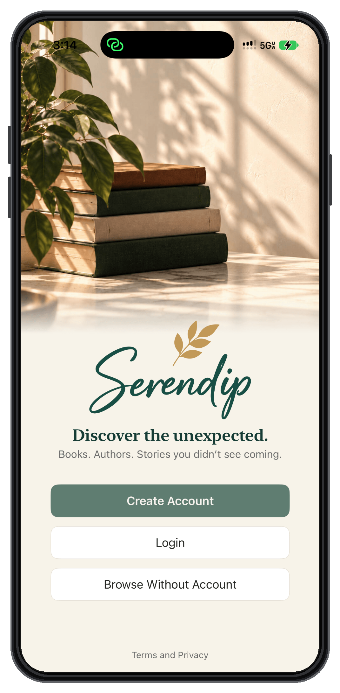
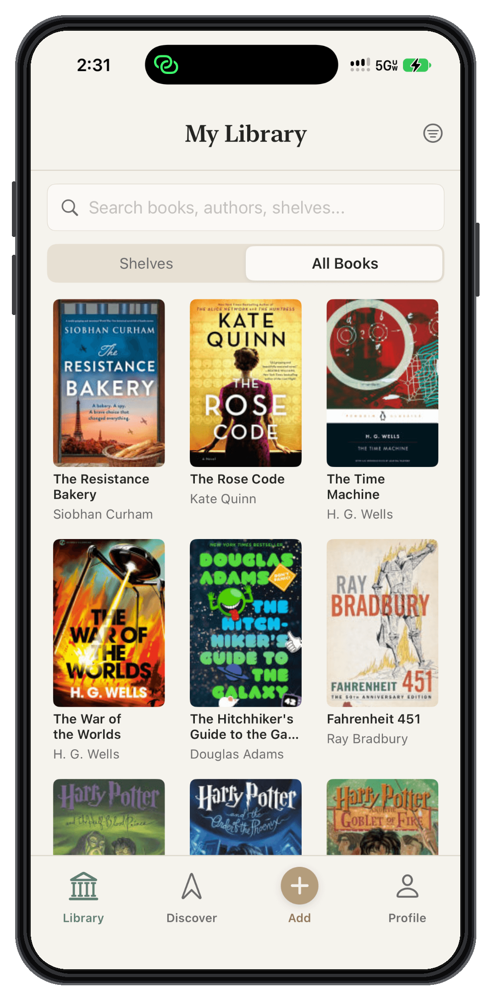
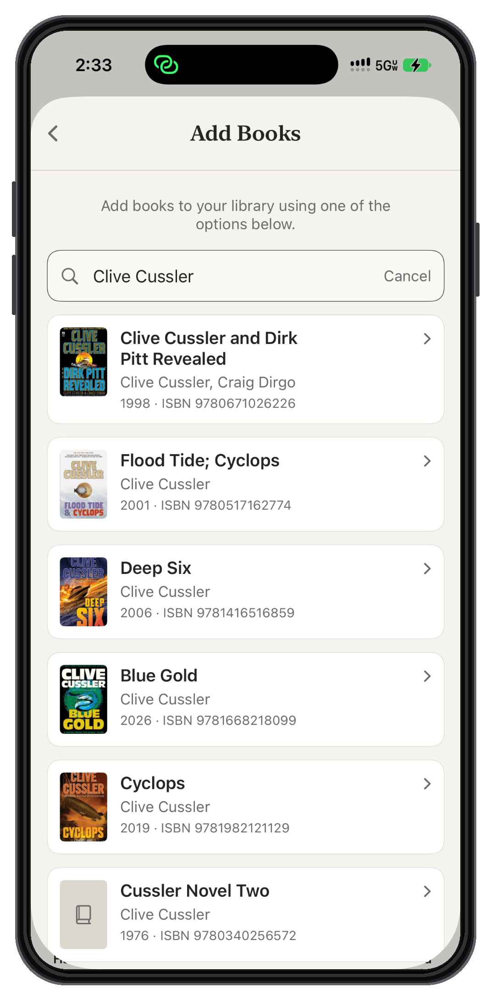
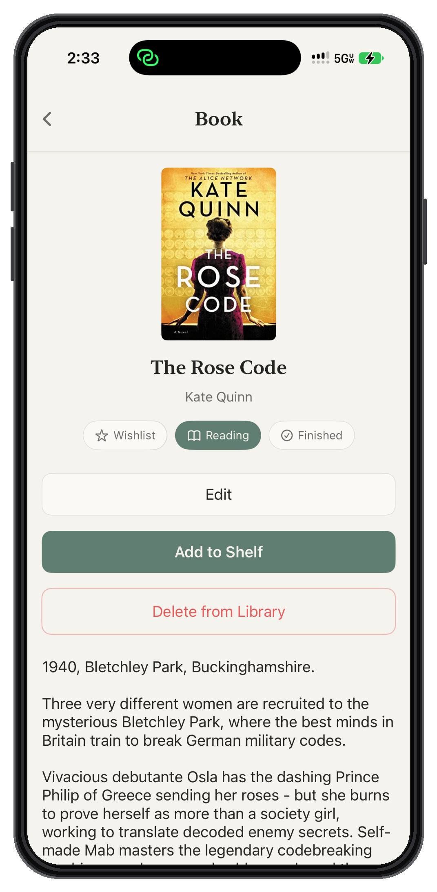
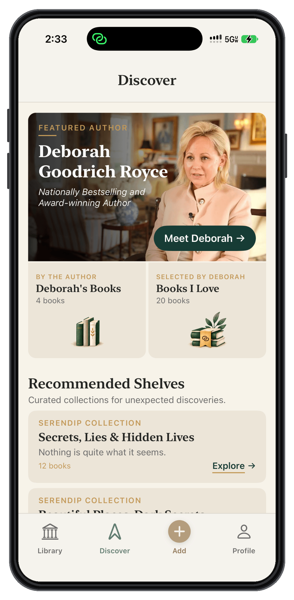

# Serendip — Native iOS Application Case Study

**Swift · SwiftUI · MVVM · Supabase · PostgreSQL · Google Books API**

> A portfolio case study of a working iOS application MVP. The application source code and proprietary implementation details remain private.

## 🧭 Overview

Serendip is a native iOS application for organizing a personal book library and discovering books to read. I started the project to address two problems I encountered myself: keeping track of books I had read or wanted to read, and finding a straightforward way to manage that information without unnecessary interface complexity.

I developed Serendip from initial UX concepts into a working MVP, integrating native iOS interfaces, backend persistence, and third-party book metadata.

**Status:** Working MVP; development and validation are ongoing.  
**Milestone:** Presented and demonstrated the MVP to a prospective partner, explaining the application and its core user experience.

<!-- IMAGE: Intro screen. Keep this as a single opening image; it establishes product identity. Confirm the final framed PNG matches the screenshots below. -->

## 👨‍💻 My Role

I lead the product's design and development, including:

- Defining requirements and mapping user workflows
- Designing interfaces and interaction patterns
- Building native iOS functionality with Swift and SwiftUI
- Applying MVVM principles to organize presentation and application responsibilities
- Integrating external book metadata and backend data persistence
- Testing, debugging, and iterating on the MVP
- Preparing and presenting a working demonstration to an external stakeholder

My workflow combines hands-on product and application development with AI-assisted implementation, debugging, and iteration. I use Xcode, Cursor, and ChatGPT alongside design review, troubleshooting, and validation.

## 🛠️ Technology & Tools

| Area | Technologies / approach |
| --- | --- |
| Native iOS | Swift, SwiftUI |
| Application organization | MVVM |
| Backend and persistence | Supabase, PostgreSQL |
| External data | Google Books API |
| Interface design | Adobe XD, iterative UI refinement |
| Development | Xcode, Git/GitHub, Cursor, ChatGPT |

## 📱 Selected Application Screens

The following screens illustrate the MVP's interface and key user-facing workflows. They are selected examples, not a complete feature inventory.

### Library

<!-- IMAGE: Use the current All Books screenshot in its matching, straight-on iPhone frame. This shows populated content, consistent layout, and navigation. -->

A browsable personal library with clear visual hierarchy and straightforward access to saved books.

### Add a Book via Search

<!-- IMAGE: Use the existing Clive Cussler search-results screenshot. Check that the framed version preserves legible titles and does not alter book metadata. -->

A search-driven entry point that presents external book information in a format users can quickly scan and act on.

### Book Detail

<!-- IMAGE: Use The Rose Code screenshot. It visibly demonstrates book metadata and reading-status actions. Review the visible text and controls before publication. -->

A focused view of book information and personal-library actions, including reading-status management.

### Discover

<!-- IMAGE: This screen discloses visible author and curated-collection features. Publish only if you are comfortable showing these publicly. If not, remove this subsection and image. -->

A visually organized browsing experience designed to make exploring books and authors approachable.

## 🏗️ Engineering Approach

### Native, State-Driven UI

I developed the interface in SwiftUI, using its declarative model to connect what appears on screen with application state. Consistent navigation and reusable interaction patterns help keep common workflows understandable as the application evolves.

### Separation of Responsibilities

I use MVVM principles to organize view presentation, application state, and data-related work. This provides a practical structure for refining screens and behavior without treating each interface as an isolated implementation.

### External Data and Persistence

Serendip brings together book metadata from the Google Books API and user-managed library information persisted through Supabase and PostgreSQL. The application coordinates data retrieval and saved user records within its book-management workflows.

<!-- TECHNICAL REVIEW: Verify this description against the current project. Do not add claims about offline support, advanced synchronization, security guarantees, performance, or test coverage without evidence. -->

## ⚙️ Engineering Decisions & Tradeoffs

### 1. Prioritizing Common Tasks

**Consideration:** Finding, saving, and managing books should not require users to navigate unnecessary complexity.

**Decision:** Favor direct actions, readable information, and consistent interaction patterns over feature-heavy screens.

**Result:** The MVP provides focused workflows for searching for books and managing a personal library.

### 2. Organizing Application State with MVVM

**Consideration:** Multiple screens and user actions require a maintainable way to organize presentation and application behavior.

**Decision:** Combine SwiftUI's state-driven interface model with MVVM principles to separate responsibilities.

**Result:** A structured foundation for implementing and refining the MVP's views and workflows.

### 3. Integrating Book Metadata with User-Managed Records

**Consideration:** External book information and a user's saved library data have different roles.

**Decision:** Integrate book metadata retrieval with backend persistence while keeping the user-facing search and save experience straightforward.

**Result:** Users can search for books and manage records in their personal library.

<!-- INTERVIEW PREPARATION: These are design and engineering decisions, not claims about specific bugs or complex incidents. Consider adding one verified example of an actual technical obstacle, the alternatives considered, and how you tested the solution. Do not disclose proprietary logic or database structures. -->

## ✅ MVP Status & Validation

The MVP includes account creation, book search, adding books to a personal library, reading-status updates, and retrieval of saved information across sessions.

The application has also been demonstrated to a prospective partner. Serendip remains an active development project; this case study does not represent a public App Store release or an established commercial partnership.

<!-- VERIFY BEFORE PUBLICATION: Confirm the complete flow on the current build: create/sign in -> search -> add -> change status -> force quit -> relaunch/sign in -> verify saved book and status. If any step does not work, revise the paragraph above to reflect what is verified. -->

## 🎨 UX/UI Principles

- **Clarity:** Make the primary task easy to identify.
- **Consistency:** Reuse familiar layout and interaction patterns.
- **Efficiency:** Reduce avoidable steps in routine workflows.
- **Readability:** Use clear typography, spacing, and content hierarchy.
- **Restraint:** Favor purposeful functionality over interface clutter.

## 🎯 What This Project Demonstrates

Serendip brings together capabilities that span native iOS development and broader software engineering:

- Taking an application from requirements and UX design to a working MVP
- Implementing native SwiftUI interfaces with an MVVM-oriented structure
- Integrating external APIs and backend persistence
- Making practical tradeoffs between usability and implementation complexity
- Iterating through testing, debugging, and review
- Explaining and demonstrating software to a prospective external partner

## 🔒 Repository Scope

This is a **documentation-only portfolio repository**. Application source code, internal data structures, proprietary implementation details, credentials, unreleased specifications, and commercial plans are not included.

<!-- PRE-PUBLICATION CHECKLIST:
[ ] Verify the end-to-end MVP workflow and all technical claims.
[ ] Confirm each screenshot is from the current app and the iPhone framing is consistent.
[ ] Review Discover and other screenshots for product details you do not want public.
[ ] Check images for personal data, debug information, internal URLs, or sensitive content.
[ ] Verify image filenames and links work on GitHub.
[ ] Inspect the repository's full commit history for accidentally committed private material.
[ ] Review the public repository from a logged-out browser window.
-->

## 🔗 Other Work

- [Data Center QC Dashboard](https://github.com/samdev-pro/Data-Center-QC-Dashboard)
- [KPI Construction Bot](https://github.com/samdev-pro/KPI-Construction-Bot)

## 🤝 Contact

Interested in discussing iOS development or software engineering opportunities? Let’s connect. 
📧 [Email Me](mailto:sam@samhuss.dev)  💼 [LinkedIn](https://www.linkedin.com/in/samhuss/)
